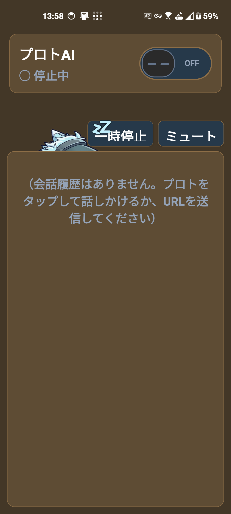
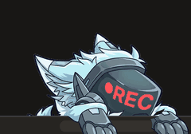
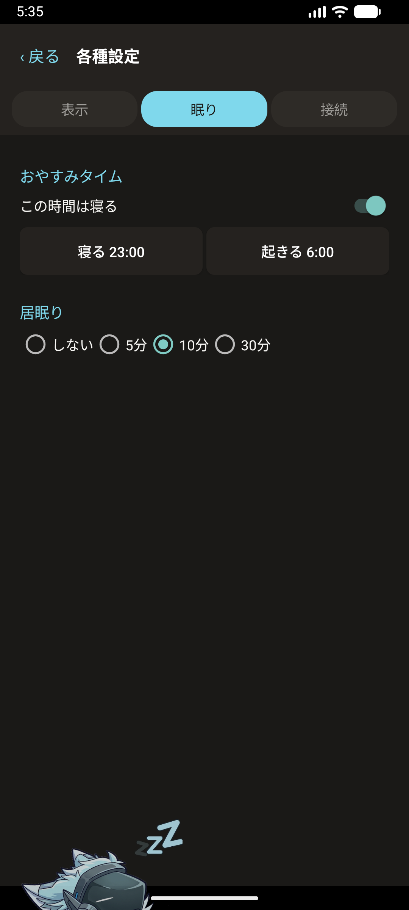
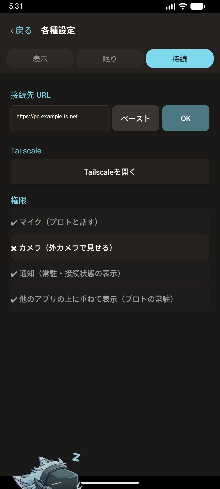

# ProtoOverlay

ProtoOverlay is an Android companion app that places the animated mascot “Proto” over other apps and connects it to a PC-side AI agent through LiveKit.

<p align="center">
     
</p>

> **In development:** This repository contains the Android app only. It does not include the PC agent, token endpoint, or LiveKit server. Those components must be set up separately.



## Proto’s expressions and motions

Proto peeks from the screen edge or clings to the edge of the input bar, and changes its face and motion with the conversation state. Every frame is drawn by layering 480×309 transparent PNG parts (body, eyes, mouth, paws, badges); the motion is computed in the app.

<table>
<tr>
<td align="center"><br><sub>Idle: sway + blink</sub></td><td align="center"><br><sub>Talking: looks up, mouth flaps</sub></td><td align="center"><br><sub>Thinking: “?” above the head</sub></td><td align="center"><br><sub>Listening: alert lines</sub></td>
</tr>
<tr>
<td align="center"><br><sub>Happy: hops</sub></td><td align="center"><br><sub>Dozing: nods off → Zzz</sub></td><td align="center"><br><sub>Camera on: ●REC</sub></td><td align="center"><br><sub>Charging: battery on the forehead</sub></td>
</tr>
</table>

## Emulator screenshots

These are views of the dashboard, appearance settings, sleep and idle settings, and connection settings on Android. The private hostname in the connection screenshot has been replaced with an example address.

<table>
<tr>
<td align="center"><a href="docs/images/screenshots/dashboard.png"><br><sub>Dashboard</sub></a></td>
<td align="center"><a href="docs/images/screenshots/appearance-settings.png"><br><sub>Appearance and color settings</sub></a></td>
</tr>
<tr>
<td align="center"><a href="docs/images/screenshots/sleep-settings.png"><br><sub>Sleep and idle settings</sub></a></td>
<td align="center"><a href="docs/images/screenshots/connection-settings-redacted.png"><br><sub>Connection and permission settings (example hostname)</sub></a></td>
</tr>
</table>

<p align="center">
  <a href="docs/images/proto-app-icon.png"></a>
</p>

**Assets:** [Download preview images and app icon](docs/downloads/ProtoOverlay-Preview-Assets.zip) · [Screenshot details](docs/SCREENSHOTS.md)

## Features

- Persistent animated mascot overlay
- LiveKit voice calls, connection state, and transcription display
- Share images and links from Android to the PC-side agent
- Optional camera and screen sharing, subject to Android permissions and server support
- Appearance, idle, mute, and pause settings

## Components and networking

The Android app requests a token from the configured PC-side service at `/token?character=proto`. The endpoint must return JSON containing `url` and `token`. The app then connects to the LiveKit room at that URL. The PC-side agent and server are not part of this repository.

Tailscale can provide private reachability between the phone and PC. The app does not directly control Tailscale or embed its SDK. LiveKit media connectivity, TLS, firewall rules, UDP, and TURN configuration depend on the server deployment; not all media traffic automatically travels through Tailscale.

See the [user setup guide](docs/SETUP.md) before installing.

## Install

Download an APK from [GitHub Releases](https://github.com/Wendi-Notes/ProtoOverlay/releases) when one is available. If no release is listed, a distributable APK has not been published yet.

Requires Android 11 (API 30) or later. Overlay, microphone, and notification permissions are needed; camera and screen capture are optional.

## Build and modify

This is a complete Android application project, not a standalone Android SDK/library.

Requirements: Android Studio, Android SDK Platform 36, and JDK 17.

```powershell
git clone https://github.com/Wendi-Notes/ProtoOverlay.git
cd ProtoOverlay
.\gradlew.bat assembleDebug
```

The debug APK is written to `app/build/outputs/apk/debug/app-debug.apk`. See the [developer guide](docs/DEVELOPMENT.md) for signing and release-key handling. Never commit a private signing key or its passwords.

## License

The original project is licensed under the [Apache License 2.0](LICENSE). Third-party components and assets may have separate terms; see [NOTICE](NOTICE).
