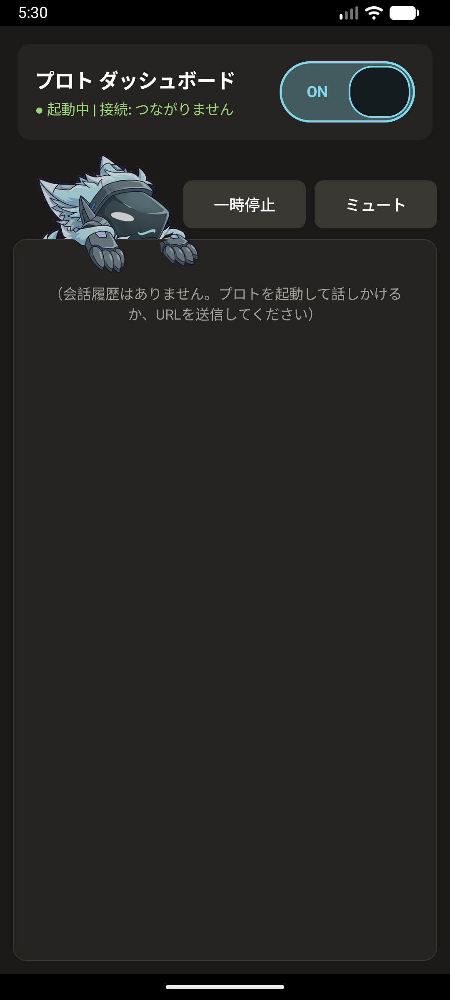
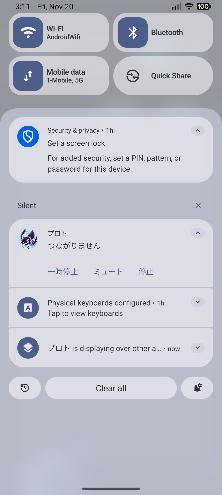
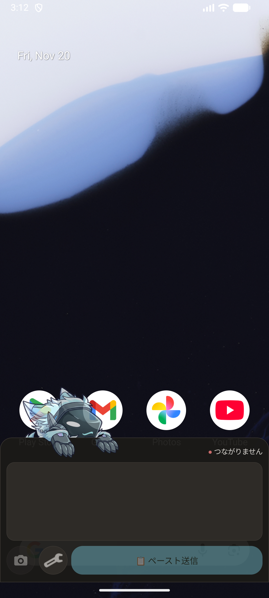
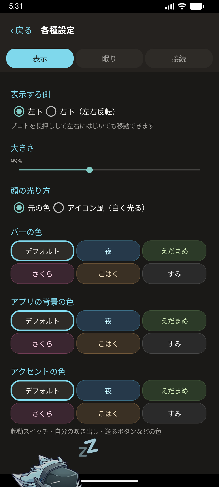
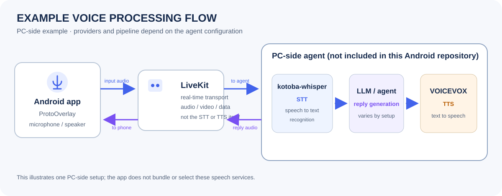

# ProtoOverlay

ProtoOverlay is an Android companion app that places the animated mascot “Proto” over other apps and connects it to a PC-side AI agent through LiveKit.

<p align="center">
     
</p>

> **In development:** This repository contains the Android app only. It does not include the PC agent, token endpoint, or LiveKit server. Those components must be set up separately.


## Proto’s expressions and motions

Proto peeks from the screen edge or clings to the edge of the input bar, and changes its face and motion with the conversation state. Every frame is drawn by layering 480×309 transparent PNG parts (body, eyes, mouth, paws, badges); the motion is computed in the app.

<table>
<tr>
<td align="center"><br><sub>Idle: sway + blink</sub></td><td align="center"><br><sub>Talking: looks up, mouth flaps</sub></td><td align="center"><br><sub>Thinking: “?” above the head</sub></td><td align="center"><br><sub>Listening: alert lines</sub></td>
</tr>
<tr>
<td align="center"><br><sub>Happy: hops</sub></td><td align="center"><br><sub>Dozing: nods off → Zzz</sub></td><td align="center"><br><sub>Camera on: ●REC</sub></td><td align="center"><br><sub>Charging: battery on the forehead</sub></td>
</tr>
</table>

## App screenshots

The dashboard provides pause and LiveKit incoming-audio mute controls. Mute applies only to audio received by this app; it does not change the device-wide volume. The notification shade also provides pause, mute, and stop actions. These current screenshots were captured in an emulator that was not connected to a PC-side service.

<table>
<tr>
<td align="center"><a href="docs/images/screenshots/dashboard.png"><br><sub>Dashboard</sub></a></td>
<td align="center"><a href="docs/images/screenshots/notification-controls.png"><br><sub>Notification actions (pause, mute, stop)</sub></a></td>
</tr>
<tr>
<td align="center"><a href="docs/images/screenshots/mascot-overlay.png"><br><sub>Persistent mascot in the bottom-left</sub></a></td>
<td align="center"><a href="docs/images/screenshots/mascot-panel.png"><br><sub>Input panel opened by tapping Proto</sub></a></td>
</tr>
<tr>
<td align="center"><a href="docs/images/screenshots/appearance-settings.png"><br><sub>Appearance and color settings</sub></a></td>
<td align="center"><a href="docs/images/screenshots/sleep-settings.png"><br><sub>Sleep and idle settings</sub></a></td>
</tr>
</table>

The private hostname in the connection-settings screenshot has been replaced with an example address.

<p align="center">
  <a href="docs/images/proto-app-icon.png"></a>
</p>

**Assets:** [Download preview images and app icon](docs/downloads/ProtoOverlay-Preview-Assets.zip) · [Screenshot details](docs/SCREENSHOTS.md)

### On a real device

<p align="center"></p>

Tap Proto dozing in the bottom-left corner and it rises with the input bar, clinging to its edge. From the bar you can send text or links, toggle the camera, and see the conversation. Close it and Proto goes back to the screen edge.

## Features

- Persistent animated mascot overlay
- LiveKit voice calls, connection state, and transcription display
- Share images and links from Android to the PC-side agent
- Optional camera and screen sharing, subject to Android permissions and server support
- Appearance and idle settings, pause, and LiveKit incoming-audio mute

## Components and networking

The Android app requests a token from the configured PC-side service at `/token?character=proto`. The endpoint must return JSON containing `url` and `token`. The app then connects to the LiveKit room at that URL. The PC-side agent and server are not part of this repository.

Tailscale can provide private reachability between the phone and PC. The app does not directly control Tailscale or embed its SDK. LiveKit media connectivity, TLS, firewall rules, UDP, and TURN configuration depend on the server deployment; not all media traffic automatically travels through Tailscale.

## Voice processing options

LiveKit primarily handles real-time audio, video, and data transport. The STT and TTS services depend on the PC-side agent and LiveKit Agents configuration; LiveKit itself does not provide them universally. If the services used in a standard setup do not fit your needs or budget, consider switching to another provider supported by the agent or running STT, an LLM, and TTS locally on the PC. Costs depend on the selected services and plans. These choices are configured in the PC-side agent; the Android app does not let you switch voice-processing methods.

> **Voice output:** To hear the AI's spoken replies on your phone, configure TTS and a voice in the PC-side agent and have it publish the generated audio to LiveKit. Without that setup, the app receives no spoken AI replies. The setup and supported voice services depend on the PC-side agent.

## Example voice-processing setup (PC side)

<p align="center"></p>

In the PC-side setup used by the author, [kotoba-whisper](https://github.com/kotoba-tech/kotoba-whisper) is used for speech recognition (STT), and [VOICEVOX](https://voicevox.hiroshiba.jp/) for synthesizing spoken replies (TTS). LiveKit transports the audio; these speech services and the PC-side agent are not included in this Android repository. The actual services and voice depend on the agent's configuration.

When using VOICEVOX, follow its [software terms](https://voicevox.hiroshiba.jp/term/) and the terms for the selected voice library, and provide any required credits.

See the [user setup guide](docs/SETUP.md) before installing.

## Install

Download the APK and `app-release.apk.sha256` from [GitHub Releases](https://github.com/Wendi-Notes/ProtoOverlay/releases) when available. Verify the APK's SHA-256 against the checksum file. If no release is listed, a distributable APK has not been published yet.

Requires Android 11 (API 30) or later. Overlay, microphone, and notification permissions are needed; camera and screen capture are optional.

## Build and modify

This is a complete Android application project, not a standalone Android SDK/library.

Requirements: Android Studio, Android SDK Platform 36, and JDK 17.

```powershell
git clone https://github.com/Wendi-Notes/ProtoOverlay.git
cd ProtoOverlay
.\gradlew.bat assembleDebug
```

The debug APK is written to `app/build/outputs/apk/debug/app-debug.apk`. See the [developer guide](docs/DEVELOPMENT.en.md) for signed releases and release-key handling. Never commit a private signing key or its passwords.

## Documentation

- [User setup guide](docs/SETUP.md)
- [Developer guide (signing and GitHub Releases)](docs/DEVELOPMENT.en.md)
- [Japanese README](README.md)

## License

The original project is licensed under the [Apache License 2.0](LICENSE). Third-party components and assets may have separate terms; see [NOTICE](NOTICE).
