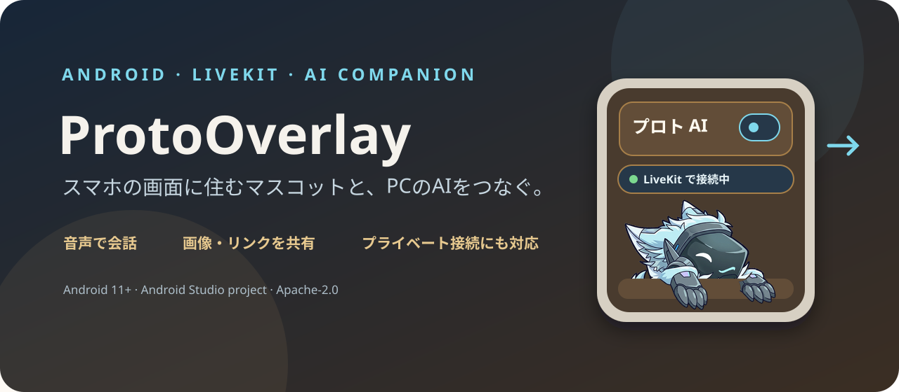
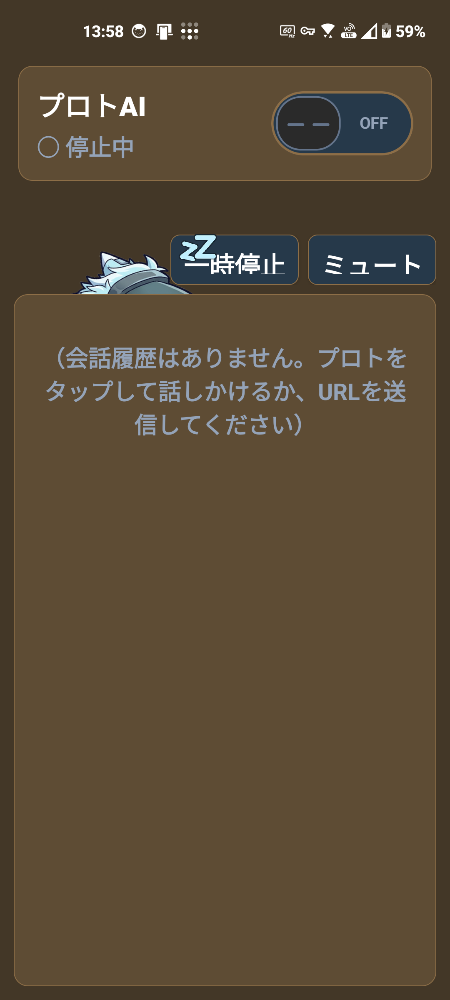
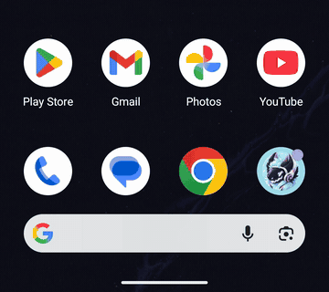
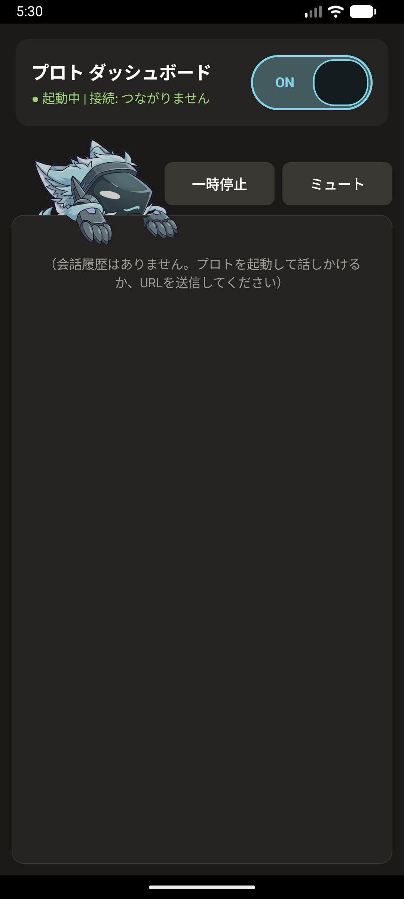
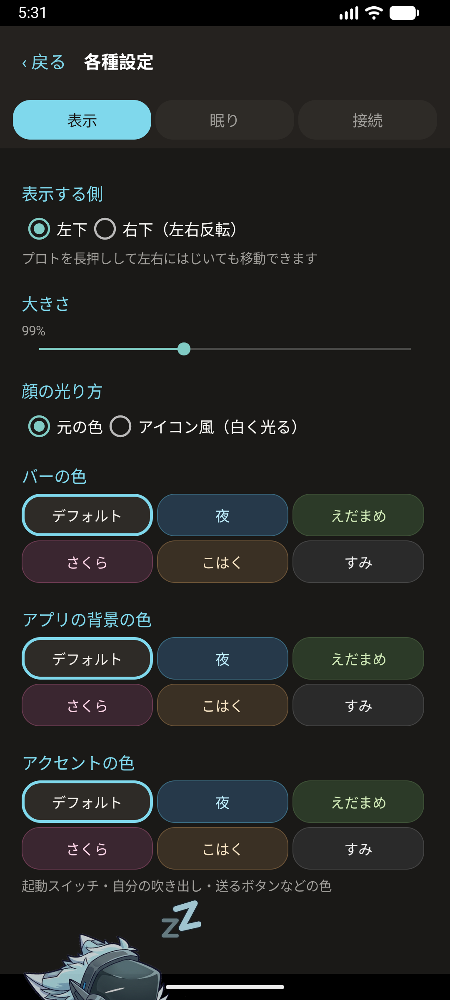
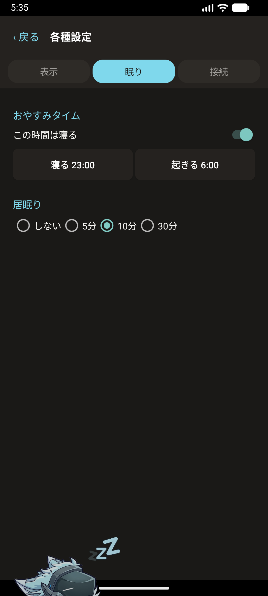
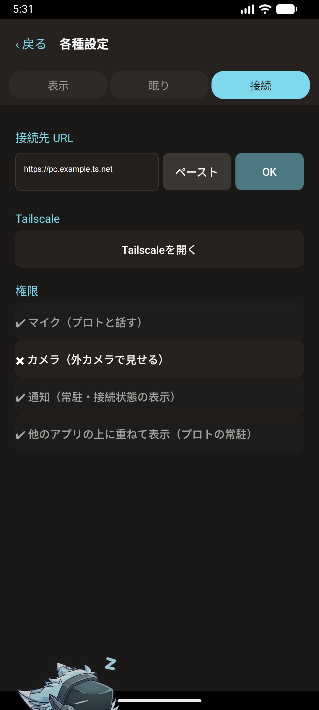
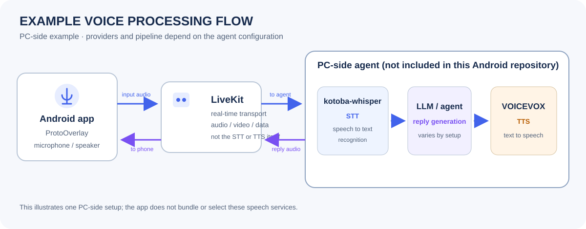

<div align="center">
  
  <p><strong>スマホの画面に住むマスコットと、PC 上の AI エージェントをつなぐ Android アプリ。</strong></p>
  <p><a href="README.en.md">English</a> · <a href="https://github.com/Wendi-Notes/ProtoOverlay/releases">ダウンロード</a> · <a href="docs/SETUP.md">セットアップガイド</a></p>
</div>

<p align="center">
     
</p>

> **開発中:** ProtoOverlay は PC 側のエージェントや LiveKit サーバーを含みません。APK を入れるだけで会話が始まる製品ではなく、PC 側の接続環境を別途用意する必要があります。

## ProtoOverlay とは

ProtoOverlay は Android 11 以降のスマートフォンにマスコット「プロト」をオーバーレイ表示し、LiveKit を通じて PC 側の AI エージェントと音声・テキスト・画像などをやりとりするコンパニオンアプリです。Tailscale を使って PC 側の接続先をプライベートに公開する構成を想定しています。



## プロトの表情と動き

プロトは画面の端からのぞいたり、操作バーのふちに前足をかけてしがみついたりしながら、会話の状態に合わせて表情と動きを変えます。絵はすべて 480×309 の透過 PNG パーツ（体・目・口・前足・マーク）の重ね合わせで、動きはアプリ内で計算しています。

<table>
<tr>
<td align="center"><br><sub>待機：ゆらゆら＋まばたき</sub></td><td align="center"><br><sub>おしゃべり：上を向いて口ぱくぱく</sub></td><td align="center"><br><sub>考え中：頭の上に「？」</sub></td><td align="center"><br><sub>聞き取り中：「ハッ」の線</sub></td>
</tr>
<tr>
<td align="center"><br><sub>うれしい：ぴょこぴょこ</sub></td><td align="center"><br><sub>居眠り：こっくり → Zzz</sub></td><td align="center"><br><sub>カメラ中：●REC</sub></td><td align="center"><br><sub>充電中：おでこに電池</sub></td>
</tr>
</table>

ほかにも、電池が少ないときの赤い点滅、夜のおやすみタイム、触らないと眠くなる、充電を始めると喜ぶ、などの反応があります。

### 実機での動き

<p align="center"></p>

左下で居眠りしているプロトをタップすると、入力バーと一緒に起き上がって、バーのふちにしがみつきます。バーからは文字やリンクの送信、カメラの切り替え、会話のやりとりの確認ができます。閉じると、また画面の端に戻ります。

## 実機スクリーンショット

スマートフォン画面のダッシュボード、表示設定、睡眠設定、接続設定です。接続設定の画面では、実際の Tailscale hostname を例示用アドレスに置き換えています。

<table>
<tr>
<td align="center"><a href="docs/images/screenshots/dashboard.png"><br><sub>ダッシュボード</sub></a></td>
<td align="center"><a href="docs/images/screenshots/appearance-settings.png"><br><sub>表示・色の設定</sub></a></td>
</tr>
<tr>
<td align="center"><a href="docs/images/screenshots/sleep-settings.png"><br><sub>睡眠・居眠りの設定</sub></a></td>
<td align="center"><a href="docs/images/screenshots/connection-settings-redacted.png"><br><sub>接続・権限の設定（hostname を例示用に置換）</sub></a></td>
</tr>
</table>

<p align="center">
  <a href="docs/images/proto-app-icon.png"></a>
</p>

**素材:** [プレビュー画像とアイコンをまとめてダウンロード](docs/downloads/ProtoOverlay-Preview-Assets.zip) · [スクリーンショット一覧](docs/SCREENSHOTS.md)

## 主な機能

- 画面の端に常駐するマスコット。まばたき、会話、考え中、眠りなどの表示
- LiveKit を使った PC 側エージェントとの音声通話、会話状態や文字起こしの表示
- 共有メニューから画像やリンクを PC 側へ送信
- PC 側の対応状況に応じたカメラ映像・画面共有
- 表示テーマ、マスコットの大きさ・位置、休止やミュートなどの設定

## 使うもの

| 要素 | 役割 |
|---|---|
| Android アプリ（このリポジトリ） | スマートフォン上のマスコットと操作画面 |
| PC 側エージェント | `/token?character=proto` を提供し、LiveKit のルームに参加する外部プログラム。このリポジトリには含まれません |
| LiveKit | 音声・映像・データ通信のルームサービス |
| 音声合成（任意） | AI の返答を音声で聞く場合に必要。サービスやローカル TTS は PC 側エージェントの実装に依存します |
| Tailscale（任意） | スマートフォンと PC をプライベートに接続するネットワーク。アプリは Tailscale の SDK や VPN API を直接操作しません |

> **音声出力について:** スマートフォンで AI の返答音声を聞くには、PC 側エージェントで音声合成（TTS）と使用する声を設定し、生成した音声を LiveKit に送る必要があります。設定がない場合、アプリに AI の返答音声は届きません。設定場所や対応する音声サービスは PC 側エージェントによって異なります。

Tailscale は接続先への到達性を提供しますが、LiveKit のすべてのメディア通信が自動的に Tailscale 経由になるわけではありません。LiveKit サーバーの公開方法、TLS、ファイアウォール、UDP が使えない場合の TURN 設定は、PC・サーバー側の構成に依存します。

## 音声処理について

LiveKit は主にリアルタイムの音声・映像・データ通信を担います。音声認識（STT）や音声合成（TTS）に使うサービスは、PC 側エージェントや LiveKit Agents の構成によって異なり、LiveKit 自体が一律に提供するものではありません。標準構成のサービスが要件や費用に合わない場合は、エージェントが対応する別のプロバイダーや PC 上のローカル／自前の STT・LLM・TTS への切り替えを検討してください。利用料金は選ぶサービスや契約によって異なります。これらの選択・設定は PC 側エージェントで行い、Android アプリから音声処理方式を切り替える機能はありません。

> **音声出力について:** スマートフォンで AI の返答音声を聞くには、PC 側エージェントで TTS と使用する声を設定し、生成した音声を LiveKit に送る必要があります。未設定の場合、アプリに AI の返答音声は届きません。

## 音声処理の構成例（PC 側）

<p align="center"></p>

著者が使用する PC 側の構成例では、音声認識（STT）に [kotoba-whisper](https://github.com/kotoba-tech/kotoba-whisper)、返答音声の合成（TTS）に [VOICEVOX](https://voicevox.hiroshiba.jp/) を使用します。LiveKit は音声を運ぶ通信基盤で、これらの音声処理サービスや PC 側エージェントはこの Android リポジトリには含まれません。実際に使うサービスや声はエージェントの設定によって異なります。

VOICEVOX を利用するときは、[ソフトウェア利用規約](https://voicevox.hiroshiba.jp/term/)と選択した音声ライブラリの規約を確認し、必要なクレジットを表記してください。

## まず試す（APK）

1. [Releases](https://github.com/Wendi-Notes/ProtoOverlay/releases) から APK をダウンロードします。リリースがまだない場合は、配布用 APK は未公開です。
2. Android でダウンロードした APK を開き、求められた場合はそのブラウザー／ファイルアプリからのインストールを許可します。
3. アプリを起動し、PC 側サービスの URL を設定します。準備する URL や必要な権限は[セットアップガイド](docs/SETUP.md)を参照してください。

このアプリは Android 11（API 30）以上を対象とします。オーバーレイ、マイク、通知などの権限が必要です。カメラと画面共有は利用する場合のみ許可してください。

> **APK 署名について:** APK は Android にインストールするため署名されています。ダウンロードページでは署名方式と SHA-256 を案内します。異なる署名鍵で作られた APK は、既存アプリの上書き更新としてインストールできません。

## 開発・改造（Android プロジェクト）

このリポジトリは Android Studio で開けるアプリのソースプロジェクトです。独立して組み込める Android SDK／ライブラリ配布物ではありません。プロジェクト全体を変更して APK をビルドできます。

1. [Android Studio](https://developer.android.com/studio) をインストールします。
2. このリポジトリを clone し、Android Studio で開きます。
3. Android SDK Platform 36 と JDK 17 を用意し、Gradle の同期後に `app` をビルドします。

```powershell
git clone https://github.com/Wendi-Notes/ProtoOverlay.git
cd ProtoOverlay
.\gradlew.bat assembleDebug
```

出力先: `app/build/outputs/apk/debug/app-debug.apk`

リリース APK の署名には、自分で保管するリリース鍵を使ってください。秘密鍵やパスワードをリポジトリに登録しないでください。`release` ビルドの署名設定や鍵管理については[開発者ガイド](docs/DEVELOPMENT.md)を参照してください。

## プロジェクト構成

```text
app/src/main/java/com/wendinotes/proto/  Android アプリの Kotlin ソース
app/src/main/res/                         アイコン、マスコット画像などのリソース
app/src/main/AndroidManifest.xml          Android 権限、Activity、Service 定義
app/build.gradle.kts                      Android アプリのビルド設定・依存関係
docs/                                     利用・開発ガイドと紹介画像
```

## プライバシーと権限

- マイク・カメラ・画面キャプチャは、通話や送信機能のために使用します。Android の許可画面や画面共有確認に同意した場合に限り利用できます。
- 接続 URL と LiveKit 通話トークンは、実行時に設定した PC 側サービスから取得します。実際に送受信する内容や保存期間は、PC 側エージェントと LiveKit の構成も確認してください。
- Tailscale アプリが端末にない場合、設定画面のボタンはアプリストアを開きます。Tailscale のアカウント・tailnet 参加設定は利用者が行います。

## 使用ライセンス

このプロジェクトのライセンスは [Apache License 2.0](LICENSE) です。条件に従い、改造・再配布できます。第三者ライブラリや素材にはそれぞれのライセンスが適用されます。詳細は [NOTICE](NOTICE) を参照してください。

## 関連ドキュメント

- [セットアップガイド（利用者向け）](docs/SETUP.md)
- [開発者ガイド（ビルド・署名）](docs/DEVELOPMENT.md)
- [変更履歴](CHANGELOG.md)
- [ライセンス](LICENSE) / [第三者ライセンス情報](NOTICE)

不具合や改善案は [GitHub Issues](https://github.com/Wendi-Notes/ProtoOverlay/issues) へどうぞ。
