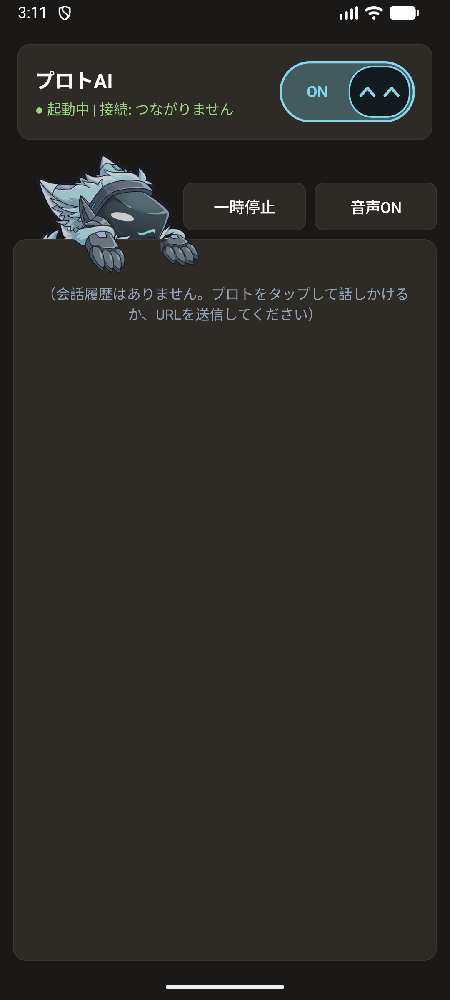
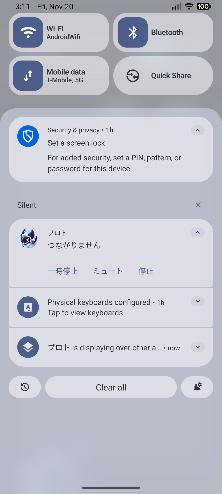
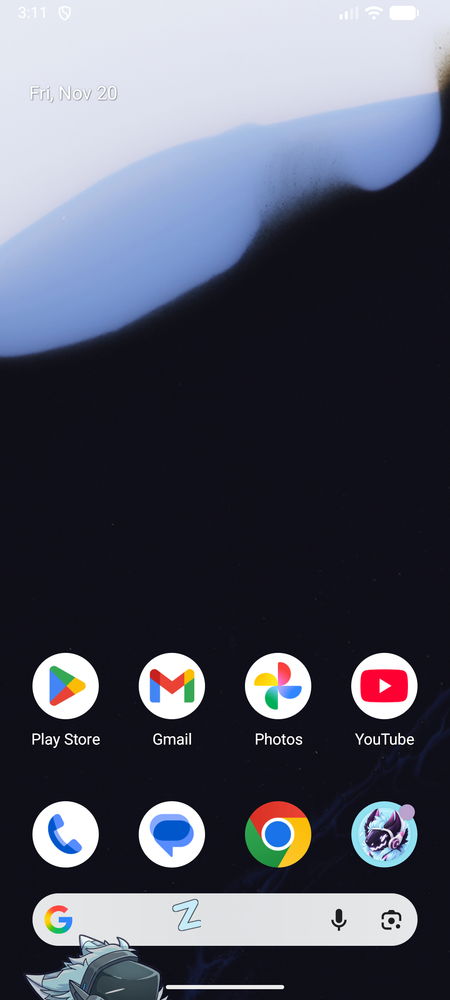
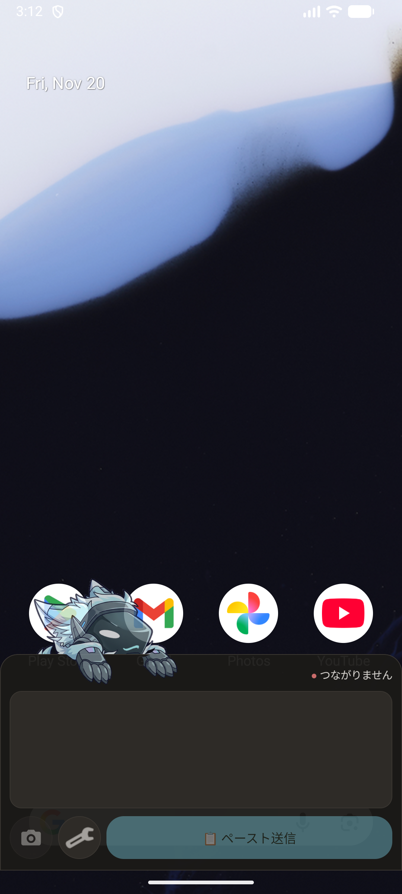
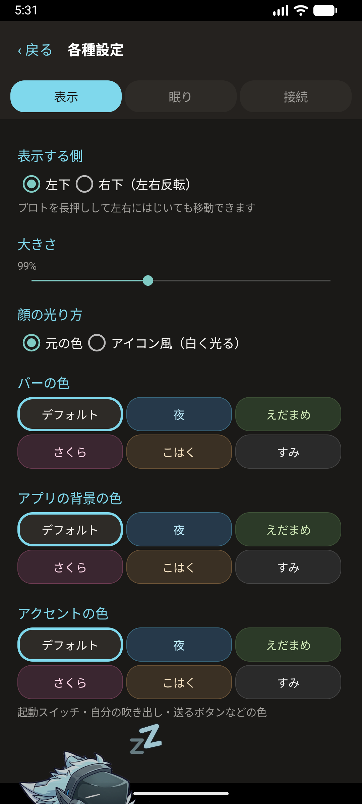
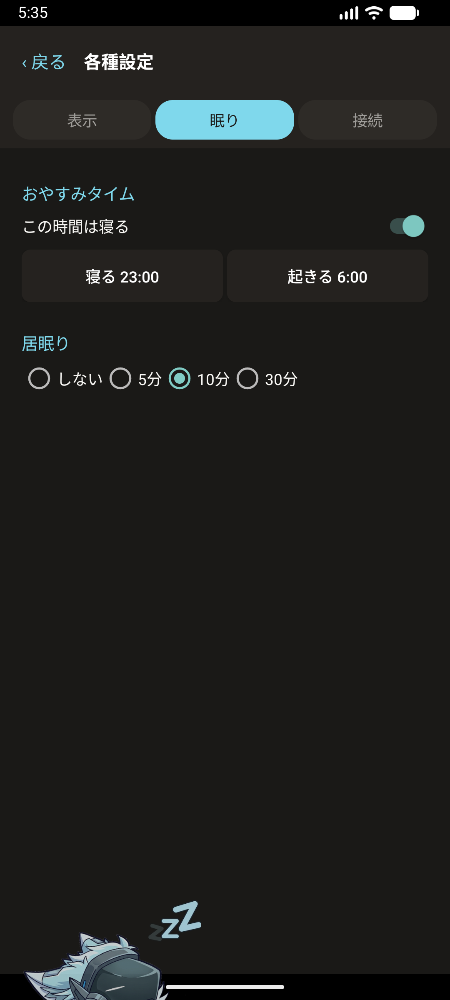
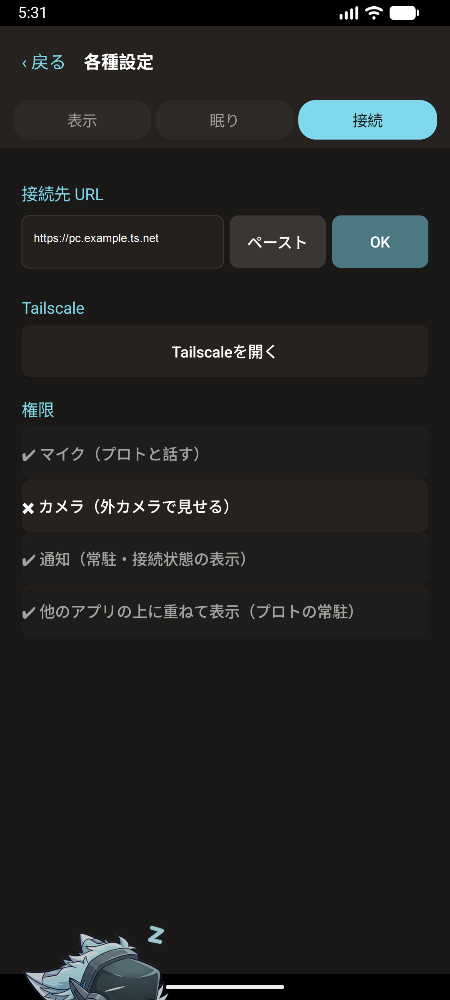

# ProtoOverlay screenshots and app icon

These screenshots were captured from ProtoOverlay running in an Android emulator. The current dashboard, notification, and mascot-overlay images show the app without a connection to a PC-side service. The connection-settings image replaces the private PC/Tailscale hostname with an example address; no real endpoint is included in these assets.

The original full-resolution screenshots are linked below and can be downloaded individually.

## Dashboard

The dashboard shows the service state, mascot, pause and mute controls, and conversation area.

## Notification controls

The expanded foreground-service notification exposes pause, mute, and stop actions. Mute affects only incoming LiveKit audio, not the device-wide volume.

## Persistent mascot

Proto remains docked at the bottom-left of the home screen while the service is running.

## Popup panel

Tapping the mascot opens the overlay panel with the conversation area and input actions.

## Appearance

Choose which screen corner the mascot uses, adjust its size and glow, and select the bar, app-background, and accent colors.

## Sleep and idle behavior

Configure the quiet-hours schedule and the idle timeout.

## Connection and permissions

Set the PC-side token-service URL and check the microphone, camera, notification, and overlay permissions. The address shown is a documentation example, not a live service.

## App icon

[Download the full-size app icon](images/proto-app-icon.png).
